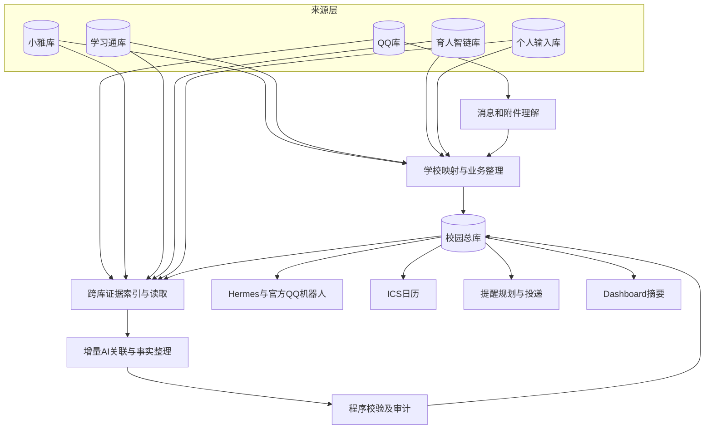
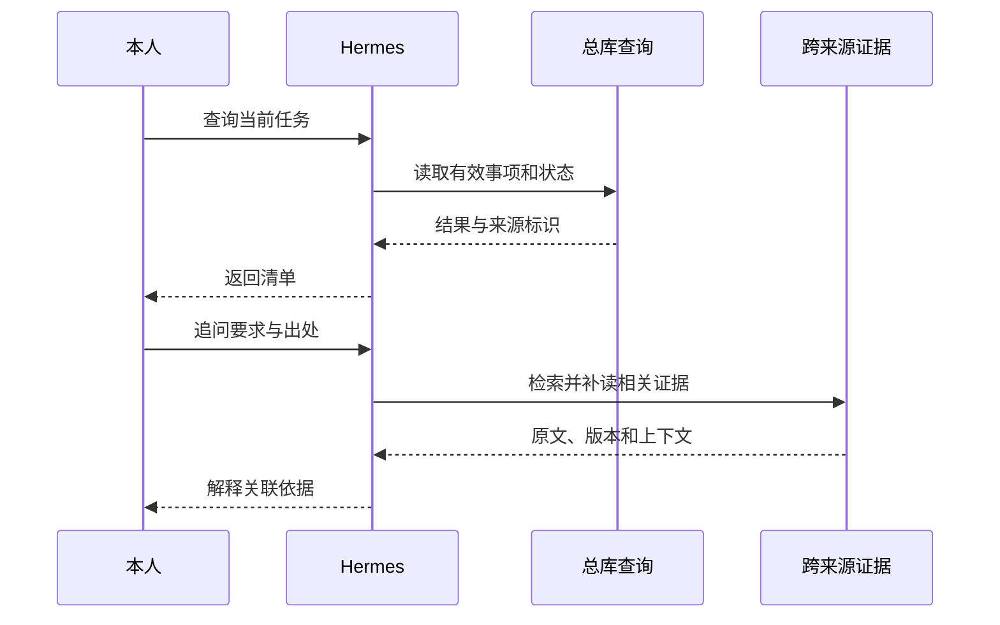

# 架构概览

Campus Hub采用“独立来源、统一业务、受控交付”的结构。五个来源库保存平台事实和本人原话，总库保存可查询的课程、事项、规则、关系及个人状态。

## 组件关系

## 来源采集

QQ通过Yogurt和只读网关接收当前授权群消息，历史补录独立分页。图片、文档和压缩包处理已有聊天附件，保留消息、文件、页码与片段引用。

育人智链和小雅使用智慧理工大本人会话，学习通使用独立账号。学校同步先保存响应和分类状态，再映射总库；采集成功而映射失败时仍可使用来源快照继续处理。

本人输入按课程补充、一般安排、资料规则及决定进入相应受控入口，保留原话和操作历史。

## 写入与续接

总库写入先取得统一协调锁，再打开写事务；同一进程的多个线程也按顺序处理。课表投影一次读取课程时段后分组，不为每门课程重复展开全库。

学校映射等待超时后保存持久续接记录。本地投影后台取得学校同步锁和总库写入锁后，读取已保存的来源快照继续映射；完成结果供原刷新任务查询。查询读取继续使用只读连接。

## 业务整理

结构化课程、排课与提交状态由程序映射。分散通知、图片、文档和自然语言由AI辅助理解，课表与一般事项使用各自业务模型。

稳定事项把实际对象与多份来源分开。课程选题按学期、项目和批次保存，任务按具体对象与章节范围识别；日期、地点属于可更新事实。

本人选择、完成、归档和订阅偏好独立保存，来源重读不会清空这些记录。

## 全局关联

一般事项和课表解释共用跨来源证据。独立关联线程随既有Hub工作进程运行：更新索引、消费新增与变更队列、先检索摘要，再按需补读原文，提交类型关系和字段事实。

程序核对实际对象、证据及当前版本后保存结果。课程归属、资料、包含、同一事项、修订和取消分别处理；只有同一事项关系参与身份去重。

小雅和学习通可以属于同学期的一门课程，原生任务仍独立，不通过课程、通知或文件间接传播提交和个人完成状态。

## 查询与交付

写入由固定客户端提交到本机服务，按身份和字段校验。日程、完成、关系纠错各有入口，Hermes日常对话不修改现有技能。

ICS和提醒读取同一有效业务结果，再各自执行发布范围与调度规则。Dashboard读取独立生成的摘要快照。

## AI与程序分工

| 工作 | 执行方式 |
| --- | --- |
| 登录、接口读取、分页和来源保存 | 程序 |
| 文本、图片、文档理解与语义关联 | AI辅助，保留证据 |
| 状态、平台边界、版本和审计 | 程序 |
| 自然语言查询、解释和操作定位 | Hermes与受控工具 |
| 空档计算、ICS、提醒与投递账本 | 程序 |

## 运行位置

甲骨文承载来源采集、总库、Hermes、QQ、日历和Dashboard校园摘要。阿里云保留现有Auth与文档站等入口。本地电脑维护源码、构建文档及提供必要登录辅助，手机使用机器人和日历订阅。

## 相关内容

[数据库](./databases.md) · [跨来源关联](./associations.md) · [服务参考](./services.md) · [源码依据](./source-reference.md)
