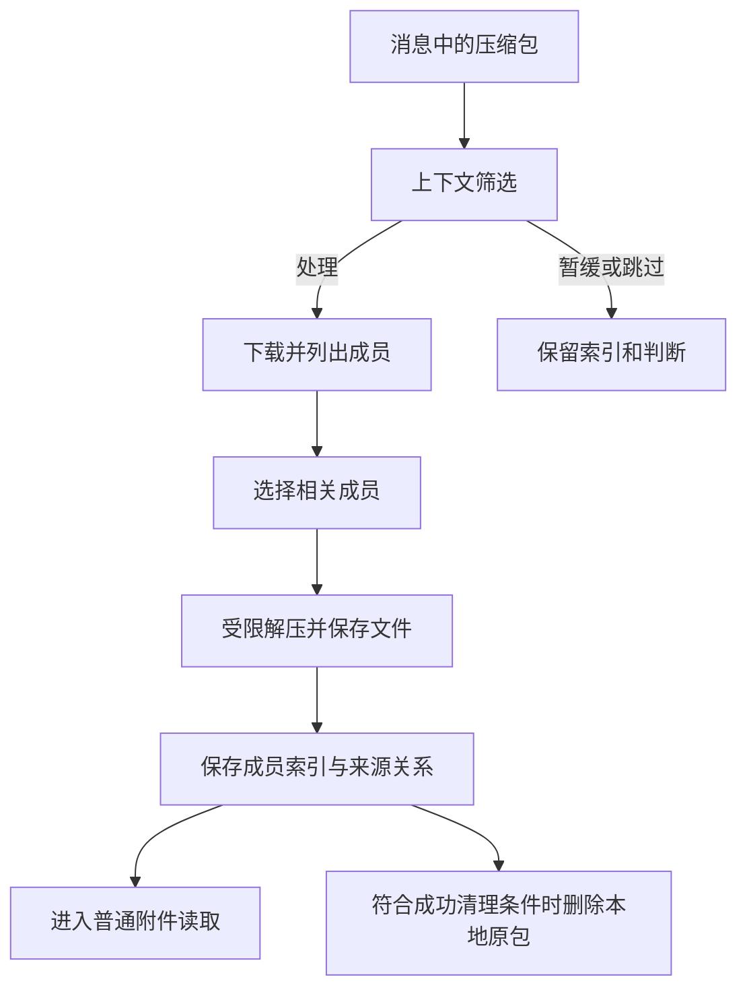

# 压缩包

压缩包处理已在当前部署中启用，支持ZIP、RAR和7z。功能目标是读取与课程、任务和通知有关的内部文件，同时保留压缩包与原消息的关系。

## 下载前筛选

程序综合以下信息决定处理方式：

- 文件名和大小。
- 群用途与关联课程。
- 上传消息配文、引用和相邻上下文。
- 是否明显为软件安装包、无关资源或课程资料。

同一个文件名在不同上下文中可以有不同结果。例如一个软件压缩包可能只有安装程序，也可能附带老师要求填写的表格；需要结合消息判断。

## 处理过程



解出文件仍按各自格式读取，不是将全部成员一次性发送给模型。

## 默认限制

以下为源码默认值，部署私有配置可以覆盖。

| 项目 | 默认值 |
| --- | --- |
| 原压缩包大小 | 128MiB |
| 单成员大小 | 128MiB |
| 解出总量 | 512MiB |
| 成员数量 | 2000 |
| 嵌套层数 | 1 |
| 单次操作超时 | 180秒 |
| CPU时间预算 | 120秒 |
| 内存预算 | 512MiB |

限制用于约束解压与内容读取资源。超过限制的压缩包可以保留索引和具体错误，不会无上限解压。

## 原包何时删除

本轮选定内容成功解出、文件已保存且索引持久化后，程序可删除服务器本地的原压缩包。仍保留：

- 原消息与压缩包附件索引。
- 内部成员列表和处理结果。
- 已解出的文件及后续理解内容。
- 文件与压缩包之间的来源关系。

失败、加密或未完整解出时保留原包。这里的删除针对服务器本地原包，不删除QQ平台上的群文件。

## 手动处理

可以要求机器人查看成员、读取指定压缩包、跳过或重新考虑之前的判断：

```text
查看这份压缩包里面有哪些文件。
```

```text
这份是老师发的实验资料，请重新考虑并读取其中的说明文档。
```

加密压缩包需要正确密码和受支持格式。密码通过受控输入处理，不记录到公开文档或命令参数。

## 使用状态

功能开关已确认开启；每个压缩包的实际结果分别记录。已展开并保存索引的记录，与等待下载、等待密码、超限和处理失败的记录应分别查看。

## 相关内容

[图片与文档](./attachments.md) · [文件状态](./states.md#附件处理) · [源码依据](./source-reference.md)
