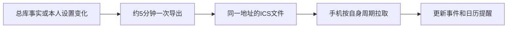

# 日历订阅

Campus Hub通过私密ICS地址持续发布安排。订阅地址保持不变，内容随总库更新；手机日历按自身周期拉取。

## 发布范围

| 包含 | 默认排除 |
| --- | --- |
| 已生效且适用本人的补充课程、实验 | 育人智链已有常规课表 |
| 必须参加或本人选定的一般安排 | 未选场次、自愿但未决定参加的活动 |
| 当前任务的实际截止时间或日期 | 已提交、已完成、归档、取消和过去截止 |

没有足够日期依据的内容不会生成日历事件。正式学校课表保留在总库，仍可通过机器人查询。

## 添加订阅

1. 通过本人维护渠道取得当前私密订阅地址。
2. 打开手机日历的账户或日历管理，选择通过URL添加订阅。
3. 粘贴地址，保存为独立日历。
4. 按需设置拉取周期和系统通知权限。
5. 查看一项真实已发布安排，核对日期和时间。

完整地址位于`api.law100.xyz`，含随机订阅密钥，手册不展示具体值。维护端查看与管理方式见[命令参考](./commands.md#日历管理)。

导入下载的ICS文件只保留当时内容；持续更新应使用URL订阅。

## 更新过程



同一事项使用稳定UID，时间和要求更新沿用原身份。明确的取消、完成和归档在后续导出中移出；历史保留在私有缓存中。

## 时间表示

有钟点的安排按实际时间段发布。只有日期的任务截止可以显示为全天事件，不补造23:59；普通会议只缺钟点时保留未知精度，不当作全天出席。

节次转为钟点使用已取得的学校边界，开始与结束时间分别处理。全部人的时间解释统一为北京时间。

## 跨来源任务

通知与一份平台作业明确对应后只发布一项，并保留原有别名和订阅设置。小雅、学习通原生任务独立，课程共同归属或资料关联不会将两份截止合并。

已生效的全局时间修订、取消和完成结果使用同一查询快照，详情中的必要要求可以进入日历描述。

日历去重使用实际事项身份，标题相近、同一课程或相同时间不会单独构成合并条件。已有发布UID沿用原对象归属；关系拆分时保留原对象UID，为独立对象分别发布。

## 单项设置

```text
这条安排不订阅到手机日历，其他内容保留。
```

```text
这条安排恢复订阅，并使用自动提醒。
```

不订阅只影响ICS，不改变总库完成状态。关闭日历闹钟则保留事件，只去掉提醒。具体模式见[提醒设置](./reminders.md)。

## 查看实际输出

```text
查看当前日历里发布了哪些事项，以及每项的提醒时间。
```

总库存在记录，不一定满足发布条件。手机仍显示旧内容时，按总库状态、导出时间、当前文件和手机拉取顺序检查。

## 地址管理

订阅支持轮换、停用和恢复。轮换后旧地址失效，手机需要改用新地址；普通业务更新无需换地址。地址配置、稳定UID和事件缓存应一起备份。

## 相关内容

[提醒设置](./reminders.md) · [完成与恢复](./completion.md) · [事项归档](./task-archive.md) · [故障排查](./troubleshooting.md#日历没有更新)
