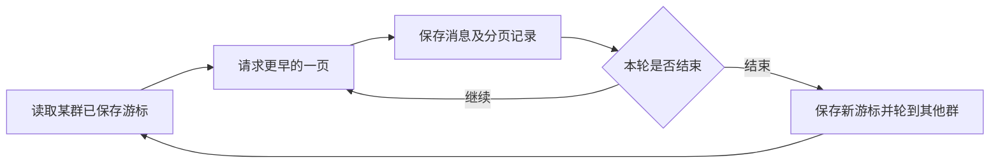

# QQ消息与历史补录

消息收集包含实时接收、近期补漏和历史向前补录三个过程。它们共享来源库，但分别维护连接与进度。

## 实时接收

采集器订阅QQ只读网关事件。收到授权群的新消息后保存到QQ库，记录最后接收时间与事件状态。

事件连接中断时会等待并重连，不以某一次断线直接认定历史数据丢失。

## 近期补漏

采集器还会按约30秒的群轮询调度检查近期消息，以补足断线或事件遗漏。当前实现使用两个轮询工作线程。

30秒是检查调度间隔。群较多、平台响应较慢或需要重试时，各群实际完成时间会不同。

## 历史向前读取

历史服务按群保存游标，逐轮向更早消息推进。当前每群每轮最多100条、最多4页，由两个工作线程调度。



这种方式让多个群轮流补录，避免某个老群长期占用整个历史通道。服务重启后从已保存位置继续。

## 可以补到多早

取决于QQ接口对当前账号返回的历史范围。系统能逐步读完接口可访问范围，不能恢复平台未返回的历史。

一页为空可能是暂时异常、边界或分页问题。程序保留状态并按规则核对，不把一次空页直接当成“该群全部历史已完成”。

## 查看覆盖

```text
查看各关注群的历史补录进度，包括最早消息时间和当前状态。
```

重点查看：

- 已保存消息的最早和最新时间。
- 当前游标是否仍推进。
- 最近一次请求是否成功。
- 状态是等待、处理、退避还是接口边界。
- 该群是否已暂停、移出或拉黑。

“历史已到可读边界”与“新消息停止接收”是不同情况。即使历史不再推进，实时接收仍应继续。

## 新关注与恢复

新关注群进入采集和历史队列。恢复暂停群时沿保留进度继续；移出后历史保留，重新加入不等于把已保存消息全部重新下载。

群在白名单中但未启用AI分析时，仍可能已经保存原文。原文收集范围和AI理解范围应分别检查。

## 排查长时间不推进

1. 确认QQ账号在线，且只读网关可用。
2. 确认该群当前启用且不在黑名单。
3. 查看实时与历史各自的最后成功时间。
4. 查看历史错误和下一次重试状态。
5. 区分没有新消息、已经到边界与服务异常。

管理端命令见[命令参考](./commands.md#qq原文与附件)。
