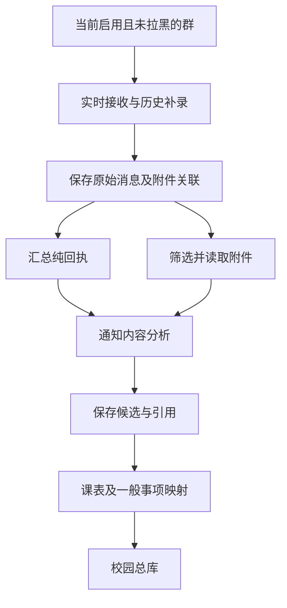

# QQ信息处理

QQ处理链路将授权群的消息和附件保存到来源库，再从中整理课程、任务、活动和规则。原消息与理解结果分别保存，以便后续核对。

## 处理流程



群的采集条件、分析开关与附件读取条件会在相应阶段检查。暂停或拉黑后，不应继续扩大该群后续处理范围。

## 原始记录

消息记录保存所在群、发送者、时间、正文、结构化消息片段、引用和文件关联。发送者显示信息以采集时可取得的QQ字段为准。

新消息和历史消息都先保存原始记录，再进入分析。AI摘要不会替换原消息；更改候选时保留修订和来源。

## 通知分析

消息分析结合群用途、关联课程、相邻消息、引用和已读附件，将分散内容整理为候选。例如：

- 同一通知分几条发送时，将时间、地点和要求关联起来。
- 图文混合消息将配文和图片内容一起理解。
- 课程安排保留课程、时段、实验题目和适用范围。
- 一般活动保留是否自愿、是否适用本人及是否需要选择。

候选进入总库前还要经过业务校验。明确适用本人的安排可以生效；身份、参与和互斥选项等问题会形成待决定事项。

## 纯回执汇总

“收到”等纯回执按时间段汇总条数和去重人数，减少模型重复读取。汇总仍能追溯到原消息。

包含请假、问题、补充说明或附件的消息继续保留实质内容。回执表示收到通知，不表示作业已完成或本人已经到场。

## 读取群原文

```text
查看某群最近关于补课的消息，给出完整上下文。
```

```text
这条事项引用了哪些消息？有没有后续更正？
```

查询时指定群名、日期或关键词可以缩小范围。结果较多时需要继续分页；历史覆盖之外的内容仍可能无法取得。

## 图片与文档

图片、普通文档和压缩包有独立的筛选与读取队列。文本分析完成不代表附件也已经完成。

- [图片与文档](./attachments.md)介绍读取条件和原件交付。
- [压缩包](./archives.md)介绍筛选、解压与原包清理。
- [消息与历史](./history.md)介绍实时接收和历史补录。

## 采集与理解的差别

“消息已入库”表示原记录已经保存；“通知已提取”表示已有候选；“事项已生效”表示总库已有可用安排。这些阶段可能在不同时间完成。

查看进度时，应明确查询哪个阶段，避免将附件排队误判为消息未采集。

## 相关内容

[QQ群管理](./groups.md) · [状态说明](./states.md) · [架构概览](./architecture.md)
