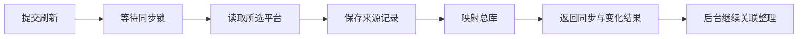

# 数据刷新

数据刷新从育人智链、小雅和学习通读取最新内容，再将取得的数据映射到总库。来源同步、AI整理、日历导出和手机刷新是不同阶段。

## 自动刷新

人的日期和调度时间均使用北京时间。

| 过程 | 当前周期与范围 |
| --- | --- |
| 学校来源同步 | 每15分钟，02:00–07:00不安排自动同步 |
| 小雅公告与作业状态 | 随学校同步，按类别保存结果 |
| 小雅大纲 | 约6小时缓存 |
| 小雅签到与资源学习 | 约30分钟分类缓存 |
| 总库本地投影 | 上轮完成后约60秒 |
| 全局证据索引 | 关联线程运行时约每分钟检查变化 |
| AI关联 | 按队列逐批处理新增、变更与依赖证据 |
| 基础资料映射 | 约10分钟 |
| ICS导出 | 上轮完成后约5分钟，手机另有拉取周期 |

分类缓存、平台响应和重试会影响完成时间。自动同步恢复后按正常轮次执行；已经开始的一轮允许正常收尾。

## 手动刷新

```text
刷新校园数据，完成后告诉我各平台结果和本次变化。
```

```text
只刷新学习通，查看这份作业的提交状态是否改变。
```

手动入口支持全部来源或单独选择小雅、育人智链、学习通，不受学校自动同步的夜间时段限制。QQ实时采集和历史补录由独立后台负责。

## 刷新过程



请求返回任务标识后，继续查询同一个任务。相同范围已有任务时可以复用；等待同步锁表示前一轮还未结束。

| 状态 | 含义 |
| --- | --- |
| 排队、等待 | 尚未开始，或正在等待同步锁 |
| 执行中 | 正在读取平台或映射 |
| 成功 | 所选来源与本轮映射已完成 |
| 部分成功 | 部分来源或映射失败，其他结果已保存 |
| 失败、中断 | 查看具体失败阶段及上次成功时间 |

同步完成不表示历史关联队列全部处理完。全局整理进度见[跨来源关联](./associations.md)和[Dashboard](./dashboard.md)。

## 阅读结果

结果区分当前总量、本次新增和本次变更，并记录等待、执行耗时和最近成功时间。平台作业清单与待办列表可能引用同一任务，不能直接相加；课表节数与连续课次也分别统计。

只需查看时效时，可以询问“各平台最近一次成功同步是什么时候”，这不会启动同步。

## 登录异常

会话失效后服务器尝试私有凭据登录，人工验证交由本人完成。失败时保留上次有效数据，并指出失败范围。学习通人工验证的具体续接能力见[学校平台](./school-platforms.md#登录与同步)。

## 相关内容

[学校平台](./school-platforms.md) · [故障排查](./troubleshooting.md#学校同步失败) · [服务参考](./services.md)
