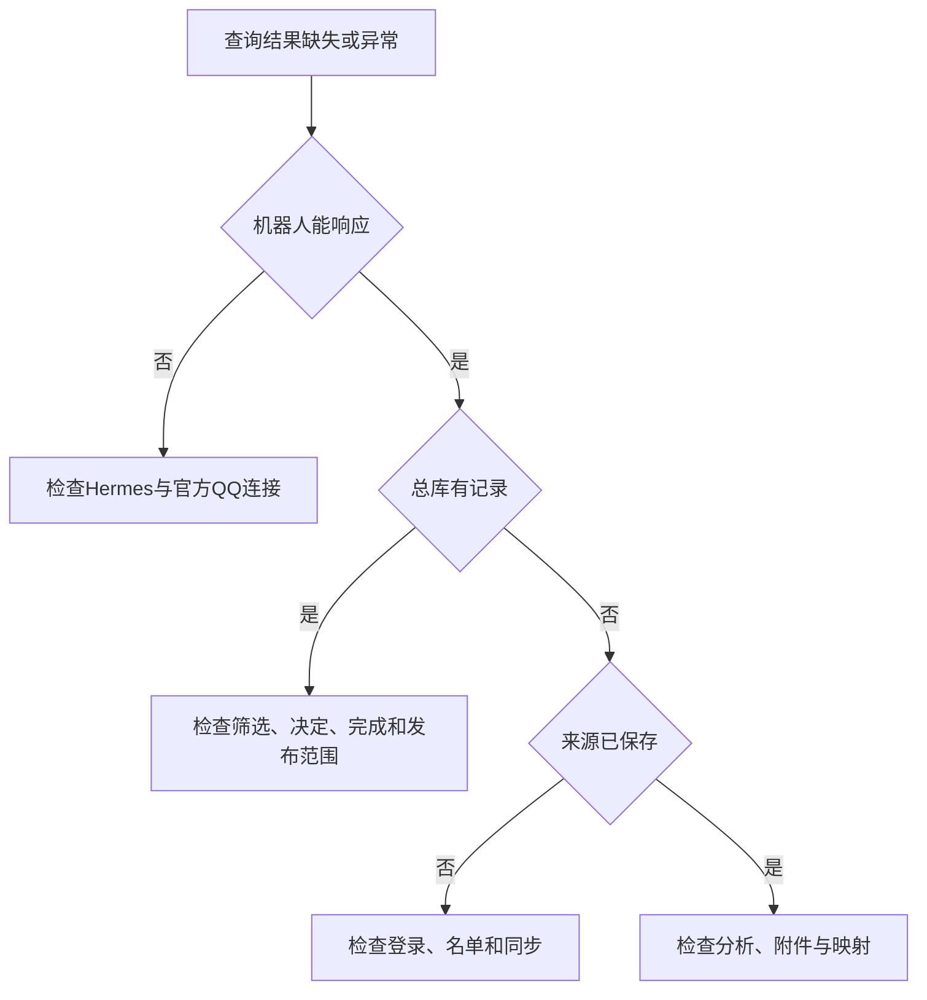

# 故障排查

先定位接入、来源、处理、总库或交付阶段，再检查对应状态。各模块独立运行，单个页面或附件失败不代表所有数据服务不可用。

## 排查顺序



## 机器人没有响应

检查Hermes是否运行、官方QQ连接与模型是否报错，再核对校园查询：

```sh
systemctl list-units --all --no-pager '*hermes*'
sudo -u hermes campus-query status
```

总库查询成功而机器人无响应时，优先检查机器人接入和模型层。

## 学校同步失败

### 现象

来源返回503、登录失效、验证码要求，或最近成功时间长期不变。

### 检查

手动刷新单个平台，查看最终结果。区分来源请求失败、会话失效、人工验证和总库映射失败。

```sh
sudo journalctl -u law100-campus-sync.service --since '1 hour ago' -n 100 --no-pager
```

### 处理

有效会话继续复用，失效后由服务器尝试凭据登录。验证码由本人完成，再确认会话导入及同步结果。

暂时失败时保留上次成功数据，检查其更新时间。不能用旧数据总量说明本轮已成功。

## 刷新持续等待

查询同一个jobId，确认是否等待同步锁，再检查当前学校同步服务及日志。相同范围任务可能复用已有任务，不需要反复start。

正在执行的请求可能耗时较长，应先确认超时和进度，不通过删除锁文件绕过。

## QQ没有新消息

依次检查Yogurt与只读网关、目标群启用和黑名单、实时最后接收时间、近期补漏时间，以及该群最近是否有新消息。

原文已保存但总库无事项时，继续检查分析范围、附件队列和映射，而不是重新归因于采集。

## 历史补录不推进

查看每群游标、最早消息时间、最近错误和重试状态。接口可读边界、群暂停与服务异常分别处理。

历史补录到边界后，实时通道仍应接收新消息。时区修改不应清除历史游标，应核对实际记录与服务状态。

## 附件无法读取

查看具体状态：按需、跳过、不可获取、解析失败或部分完成。下载地址失效与模型错误属于不同阶段。

明确请求可触发受控补读。原件已无法下载时保留索引，必要时补充本人已有文件。已确认不可获取内容不应无限自动重试。

## 事项重复出现

比较课程、学期、通知轮次与实际时段，查看稳定事项关联和本人决定。相同标题可能属于不同事件；同轮转发也不应重复生成义务。

可以请求机器人比较两条记录及已有决定，再确定合并、撤回或修正来源关系。

## 跨来源关联未出现

先确认原文或平台记录已保存，再查看全局索引覆盖及关联队列。已索引、已完成分析和已建立关系是不同状态；初始数据需要逐批处理。

```sh
sudo -u hermes campus-query association-status
sudo -u hermes campus-query global-search --keyword '实际关键词'
```

存在证据但未关联时，核对课程学期、平台、具体对象和上下文。等待证据不等于需要本人作决定。小雅、学习通同名任务保持独立属于正常策略。

## 关联或修订有误

查询关系与引用原文，区分同一事项、课程归属、资料和包含。明确错误可以要求解除关系，系统保存本人纠正；实际时间或地点错误则按日程编辑处理。

修改前保留原关系和证据，不通过删除来源或清空总库解决重复。个人完成、归档与平台提交分别检查。

## 旧事项仍在列表

确认看到的是默认待办、历史、课程查询还是手机缓存。自动归档按北京时间今天之前处理，正式课表和今天的事项保留；本人明确恢复的条目优先。

需要继续清理时定位具体事项并归档，已经做完则标记完成。手机旧内容还需等待ICS导出及客户端刷新。

## 作业状态不准确

区分平台已提交、本人已完成和状态未知。历史答卷存在、任务退出待办列表，都不能单独推导为已提交。

刷新对应的小雅或学习通来源后查看状态观察时间。分类失败时保留旧结果，并说明具体失败范围。

## 日历没有更新

1. 确认总库中的事项当前有效。
2. 核对是否属于ICS范围。
3. 查看日历查询和导出状态。
4. 查看当前文件更新时间。
5. 确认手机使用URL订阅，并检查客户端刷新。

```sh
systemctl status law100-campus-calendar.timer --no-pager
sudo journalctl -u law100-campus-calendar.service -n 80 --no-pager
```

常规育人智链课表不在当前ICS范围。完成、取消和单项不订阅也会使事件移出。

## 全天时间不准确

先判断是日期型截止、明确全天出席，还是缺钟点的普通安排。前两类可以使用全天；普通会议只缺时间时应保留精度。

核对来源和字段，再更正记录，不为改变显示随意填入截止时刻。

## 没有收到QQ提醒

查询实际投递状态，检查是否夜间延迟、事项是否完成或取消，以及平台是否拒绝。

```sh
sudo -u hermes campus-query reminders --limit 10
sudo journalctl -u law100-campus-notify.service --since '1 hour ago' -n 80 --no-pager
```

固定本人身份不符、平台主动消息限制和网络异常分别处理。提醒已排队、已发送与手机实际通知是不同结果。

## Dashboard异常

先用总库命令核对业务，再检查摘要任务和Dashboard自己的服务。跨来源卡片中的来源接入状态表示索引可读，学校最新成功时间需要看来源同步区域。历史不可获取附件不应全部算当前阻塞，普通资讯也不应全部算待办。

## 文档站访问异常

文档提供阿里云与GitHub Pages两个公开入口。先比较两个地址，确认是单站访问问题还是同一构建内容有误。

阿里云检查Nginx、HTTPS证书及当前静态版本；GitHub检查Actions中的构建与部署结果、Pages发布来源及资源路径。若GitHub地址跳转其他域名，检查Pages的Custom domain及仓库中的CNAME文件。页面正常而搜索失败时，继续检查搜索资源是否已随本轮产物发布。
